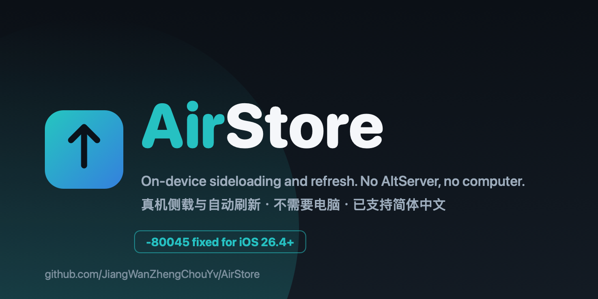

# AirStore
<p align="center"></p>

<p align="center">
  <a href="https://github.com/JiangWanZhengChouYv/AirStore/releases/latest"></a>
  <a href="https://github.com/JiangWanZhengChouYv/AirStore/actions/workflows/swiftlint.yml"></a>
  <a href="https://discord.gg/kN9Rm3kkZ"></a>
</p>

> [!CAUTION]
> **The next stable release changes the signing identifier.** The App IDs list still says **SideStore**
> because the bundle id is deliberately still `com.SideStore.SideStore` -- that is what lets AirStore
> install over an existing SideStore. The next stable switches to AirStore's own identifier, and an
> in-place update will no longer be possible: export your certificate and pairing file first (Settings),
> uninstall the old build, install the new one, then import them back.


**AirStore is a fork of SideStore that does not require an AltServer. It aims to be the better SideStore — the place a user stays, not a temporary fix for one Apple error. It started by resolving the notorious `-80045` authentication error for iOS 26.4 and above, and kept going from there.**

中文说明见 [README_zh.md](README_zh.md)。

## ⚠️ Maintenance Notice & Disclaimer

> **Maintained by a Solo Developer**
> Please note that AirStore is a solo project maintained by an independent developer in my spare time. While I will do my absolute best to fix critical issues (especially the `-80045` error), I may not be able to respond to every issue or review every PR promptly. 
> 
> **Before opening an issue, please:**
> 1. Search existing issues to avoid duplicates.
> 2. Provide detailed logs and reproduction steps.
> 
> Thank you for your patience and understanding! (我一个人肝不过来，求别催，提Issue请带详细日志！)

## 🚀 Why AirStore?

Recently, Apple tightened its GrandSlam Anisette restrictions. This caused countless users to get stuck at the `-80045` login error when trying to sign in with their Apple ID on SideStore, especially on newer iOS versions (26.4+). 

Public Anisette servers are largely blocked or unstable. AirStore gets past this by matching the client headers to the identity of the v3 Anisette server that mints them, and by signing in with that server's own client declaration. Apple ID sign-in is verified working on iOS 27.2 with a free personal account.

## ✨ Features

- **No AltServer Required:** Just like the original SideStore.
- **`-80045` Bypass:** Fixes the Apple server restrictions and login loops on iOS 26.4+.
- **Higher memory ceiling and on-device JIT:** Apps that need more RAM, and JIT for the ones that need it, requested with a free personal account.
- **Incremental updates:** An update fetches a patch against the build you have instead of the whole package.
- **Installs over mobile data:** No Wi-Fi needed to sideload or refresh. Verified on the maintainer's device with a free personal account and Wi-Fi turned off -- the "connect to a network" refusal most guides describe is not a limit here.
- **Pairing and certificate import/export:** Set up a second device, or survive a reinstall, without redoing the whole pairing dance.
- **Simplified Chinese interface.**
- **Lightweight:** Minimal footprint on your device.

Experimental: **AirBox**, a container meant to run apps without spending one of a free account's three App ID
slots. The develop builds carry the entry point, but on the test device's OS it cannot load a guest: unsigned,
ad-hoc, our own certificate and upstream zsign were all refused by the kernel on device, with JIT confirmed
attached. The entry point stays as an experiment; do not treat it as working.

## 🛠️ Installation

The current stable is [0.8.2](https://github.com/JiangWanZhengChouYv/AirStore/releases/latest).
Download `AirStore.ipa` and install it the way you already install SideStore: iloader, or the
in-app remote pairing flow. AirStore keeps SideStore's bundle id on purpose, so installing it
replaces an existing SideStore rather than sitting beside it. The Home Screen label is AirStore.
For the development builds, add the develop source described under Updates below.

Verified on device with a free personal account: sign-in including 2FA (iOS 27.2), installing and
refreshing third-party apps including incremental updates, installing over mobile data with Wi-Fi
off, and on-device JIT. AirBox (running apps inside a container) is in the develop builds but has
not loaded a guest yet. Logins still depend on a third-party Anisette server staying online -- see
the self-hosting section if you want that dependency to be yours.

### Updates

The SideStore community source lists SideStore itself as an updatable app and points that entry at
upstream's build. AirStore keeps the same bundle id, so accepting that update installs upstream
over AirStore and undoes the `-80045` fix. Add this source instead (Settings > Sources > Add Source):

```
https://raw.githubusercontent.com/JiangWanZhengChouYv/AirStore/develop/source/airstore-source.json
```

It carries only AirStore releases. If you have the SideStore source already, leave it for other
apps and ignore the SideStore update row.

## 🖥️ Self-hosting Anisette (the safest option)

**The default stays the public servers** -- nothing below is required. But a public server means your
machine identity and IP are shared with everyone else on it, and public servers do change face without
warning. Running your own removes both: the identity and the IP are yours, and to Apple the traffic looks
like one ordinary AltServer user. Account locks come from repeated wrong passwords and abuse patterns,
not from self-hosting.

```sh
docker run -d --restart always --name anisette-v3 -p 6969:6969 \
  --volume anisette-v3_data:/home/Alcoholic/.config/anisette-v3/lib/ \
  dadoum/anisette-v3-server
```

- **Keep the volume.** It holds the provisioned machine identity; minting a new machine on every restart
  is the behaviour that looks like abuse. Images exist for linux/amd64 and linux/arm64, so a Mac or a
  small VPS both work.
- In AirStore: Settings > Anisette Servers, add `http://<that machine's address>:6969` and select it.
- **Keep it to yourself.** Opening it to other people turns you back into a public server and reconnects
  the shared-identity risk you just cut.

## Building from source

Requires macOS with Xcode 15+. There is no CocoaPods in this project: do not run `pod install`,
and there is no `.xcworkspace` to open.

```sh
git clone https://github.com/JiangWanZhengChouYv/AirStore.git --recurse-submodules
cd AirStore
make build fakesign ipa        # produces AirStore.ipa
```

`fakesign` means the build carries no developer certificate, which is what you want: the app gets
its own identity from your Apple ID at first sign-in. CI builds the same way, so a packaged IPA is
also available from the Actions run for any commit.

## 💬 Feedback & Community

Settings → Send Feedback in the app offers two ways side by side: **Report an Issue on GitHub** and
**Give Feedback on Discord**.

- Issues: <https://github.com/JiangWanZhengChouYv/AirStore/issues> — attach the log, which lives in the
  Files app under **AirStore → ConsoleLogs** (newest `console_….log`). A report without one usually
  cannot be reproduced.
- Discord: <https://discord.gg/kN9Rm3kkZ> — discussion, and where the develop builds announce
  themselves. It is the fastest way to reach me; the issue tracker is still where a fix gets followed
  up.

## 🤝 Contributing

Pull requests are welcome! If you have a fix for the Anisette logic, feel free to submit a PR. However, please understand that review times may be slow due to solo maintenance.

## ⚖️ Credits & License

- Based on [SideStore](https://github.com/SideStore/SideStore)
- Based on [AltStore](https://github.com/altstoreio/AltStore)
- Licensed under the same license as the original project.
