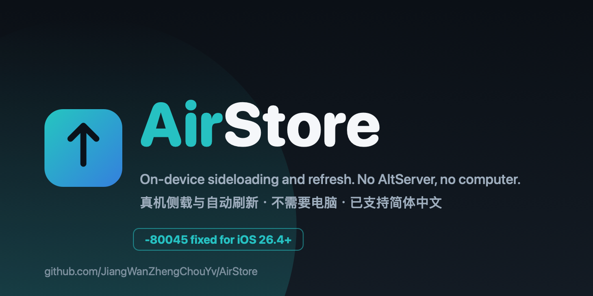

# AirStore
<p align="center"></p>

<p align="center">
  <a href="https://github.com/JiangWanZhengChouYv/AirStore/releases/latest"></a>
  <a href="https://github.com/JiangWanZhengChouYv/AirStore/actions/workflows/swiftlint.yml"></a>
  <a href="https://discord.gg/kN9Rm3kkZ"></a>
</p>

> [!CAUTION]
> **0.9.0 起签名标识已换成 AirStore 自己的。** bundle id 现在是 `com.JiangWanZhengChouYv.AirStore`
> （原来 `com.SideStore.SideStore`），所以这个版本**不能覆盖安装**旧 AirStore / SideStore，两者是独立 App。
> 换过来之前：先在设置里导出证书和配对文件，卸载旧版，装这个新版，再导入回来。旧 App Group 也不再通用，
> 旧数据不会跟过来。


中文说明（与 [README.md](README.md) 同步维护，两份内容有出入时以英文为准）。

**AirStore 是 SideStore 的 fork，不需要 AltServer。目标是做一个更好用的 SideStore —— 让人愿意一直用下去的分支，而不是只给一个苹果报错打的临时补丁。起点是解决 iOS 26.4 及以上那个 `-80045` 登录错误，然后一路做到了它前面。**

## 功能

- **不需要 AltServer**：和 SideStore 一样，全在手机本机完成。
- **绕过 `-80045`**：iOS 26.4+ 的登录死循环修好了。
- **更高的内存上限和本机 JIT**：免费个人账号也能申请到，跑需要大内存和需要 JIT 的 App。
- **增量更新**：更新只下和你当前版本对应的补丁包，不再重下整包。
- **移动数据下就能装**：侧载和刷新都不需要连 Wi-Fi。维护者真机验证：关掉 Wi-Fi、只走移动数据，免费个人账号装成功。网上常说的「请连接 Wi-Fi 才能安装」在这里不是限制。
- **配对文件与证书双向导入导出**：换设备、重装都不用重走一遍配对流程。
- **简体中文界面。**
- **轻量**：手机上占用很小。

实验性：**AirBox** 容器 —— 在容器里跑 App、不占免费账号那 3 个活跃 App 名额。真机已经能启动 guest，并带高内存权限；JIT 可以按 App 手动开启（开关、前提和步骤见 [AIRBOX.md](AIRBOX.md)）。新手引导里的「容器模式」会连同 AirBox 一起装好。

## ⚠️ 维护说明

> **单人维护**：这个项目是我业余时间一个人在做。关键问题（尤其 `-80045`）我尽力修，但不保证每条 Issue 都及时回、每个 PR 都来得及 review。
>
> **提 Issue 之前**：
> 1. 先搜一下已有 Issue，别开重复的。
> 2. 带上详细日志（Settings > Error Log > Export Log 导出）和复现步骤。没有日志的「登不上」基本没法查。
>
> 反馈走两条路：本仓库 Issues（务必带日志），或 Discord：<https://discord.gg/kN9Rm3kkZ>。
> 日常讨论 Discord 更快，修复有没有被跟进看 Issues。详见下面「反馈与交流」。

## 为什么要用 AirStore

苹果从 2026 年 10 月开始收紧 GrandSlam / Anisette 限制：请求里声明的客户端身份，必须和真正生成 `X-Apple-I-MD` 这组头的 ADI 同源。手机端的 AnisetteKit 跑的是安卓的 `libCoreADI.so`，却按 MacBook 的身份去声明，于是苹果直接拒绝，登录卡在 `-80045`，后来干脆回 503。大量公共 Anisette 服务器也属于这一类，已经不能用。

AirStore 的修法是：先读 v3 服务器自己的 `/v3/client_info`，用**服务器那对**身份和 UA 去做机器注册和登录，认证链路上每个需要一次性口令的地方都重新取一份头，并把默认服务器换成背后是真 Windows ADI 的那台，同时关掉「失败就换下一台服务器」的轮替（轮替会在 21 台里走到一台还能回头但身份是假的服务器，把真实错误盖掉）。

## 现在的验证状态（说清楚，别当成已完工）

- **已验证**（真机，免费个人 Apple ID）：登录走完 2FA 和取 Team（iOS 27.2）；第三方 App 的安装与刷新，含增量更新；关掉 Wi-Fi 只走移动数据也能装；普通 App 的本机 JIT；AirBox 容器启动 guest（高内存），容器里也可按 App 开启 JIT。
- **单点依赖**：登录要经过第三方服务器，默认 `ani3.stikstore.app`（背后是真 Mac ADI，2026-10-19 真机端到端验证过）。它挂了或者换成苹果不认的 ADI，登录会再次坏掉；手机本地那套就是被苹果拒的那套，没有本地替代。设置里可以换服务器，或按下面那节自建一台自己的。

## 快速开始（有电脑）

桌面助手是最省事的一条路：在 Mac 或 Windows 上把手机连上（USB 或同一局域网），它替你签名、安装 AirStore，并把配对文件放好。

1. 到 [AirStore Helper 预发布](https://github.com/JiangWanZhengChouYv/AirStore/releases/tag/helper-latest) 下载 `AirStoreHelper-macos.zip` 或 `AirStoreHelper-windows-x64-setup.exe`。
2. 装好，插上 iPhone，选设备。
3. 登录 Apple ID，点安装。

Windows 需要先装 iTunes（Apple Mobile Device Support）才能发现手机。这个预发布里的包由 develop 自动构建、未公证；完整步骤见 [Helper/README.md](Helper/README.md)。

## 安装

直接用[最新正式版](https://github.com/JiangWanZhengChouYv/AirStore/releases/latest)（当前 0.9.0）里的 `AirStore.ipa`，装法和平时装 SideStore 一样（iloader，或 App 内的 Remote Pairing 流程）。这个版本的 bundle id 是 AirStore 自己的 `com.JiangWanZhengChouYv.AirStore`，所以它是独立 App，**不会覆盖**旧的 AirStore / SideStore。换过来之前：导出证书和配对文件 → 卸载旧版 → 装新版 → 导入回来；旧 App Group 不通用，旧数据不会跟过来。主屏名字显示为 AirStore。想跟开发进度就加下面「更新」里那个 develop 源。

### 配对文件（手动安装）

手动用 iLoader 之类装 ipa 不会给 AirStore 留下配对文件，登录会停在「Pairing Required: No valid pairing file has been loaded」。用 **idevice_pair**（单独的一个 Mac App）生成，并让它把文件写进 AirStore 的 Documents：连上 iPhone、选设备、在手机上同意配对提示；然后在 设置 > 高级 > Pairing File Management 里导入并设为 Preferred。配对文件必须来自 idevice_pair——实测用电脑现成的配对记录导出的文件不行。

## 更新

SideStore 社区源里 SideStore 自己也是一条可更新条目，但 0.9.0 起 AirStore 是另一个 App，那条更新不会再盖掉 AirStore。AirStore 自己的更新来自这个源（Settings > Sources > Add Source）：

```
https://raw.githubusercontent.com/JiangWanZhengChouYv/AirStore/develop/source/airstore-source.json
```

它只发 AirStore 的版本。旧 AirStore（`com.SideStore.SideStore`）不能原地更新到 0.9.0，按上面「安装」里的迁移步骤走。

## 自建 Anisette 服务器（最安全）

**默认仍然是公共服务器**，下面这套不是必须的。但公共服务器意味着你的机器身份和 IP 与上面所有人共用，
而公共服务器实测会在同一天内变脸。自建把这两条都切断：身份和 IP 都是你自己的，在苹果眼里流量和一个普通
AltServer 用户没有区别。锁号来自连续错密码和滥用模式，不来自"自建"这个动作。

```sh
docker run -d --restart always --name anisette-v3 -p 6969:6969 \
  --volume anisette-v3_data:/home/Alcoholic/.config/anisette-v3/lib/ \
  dadoum/anisette-v3-server
```

- **volume 一定要留**：它存已注册的机器身份；每次重启新铸一台机器才是最像滥用的行为。镜像有
  linux/amd64 和 linux/arm64，Mac 或小 VPS 都能跑。
- AirStore 里：设置 > Anisette Servers，加 `http://<那台机器的地址>:6969` 并选中它。
- **只给自己用**：开放给别人，你就变回公共服务器，把刚切断的共用身份风险又接回来了。

## 自己查服务器能不能用

不用凭据就能看个大概，判据是它声明的身份。**下面是 2026-10-19 的探测结果；公共服务器实测会在同一天内变脸，用前自己再探一次，别照抄旧表。**

```sh
curl -s https://<服务器地址>/v3/client_info
```

- 报 `<PC> <Windows;6.2(0,0);9200>`（真 Windows ADI）：`win.ani.sidestore.io`、`ani.jkcoxson.com`、`ani2.stikstore.app`
- 报 `<MacBookPro13,3> <Mac OS X;10.12.6>`（老 Mac ADI）：`new.ani.sidestore.io`、`mac-ani.jkcoxson.com`、`ani3.stikstore.app`
- 报 `<MacBookPro13,2> <macOS;13.1;22C65>`：这就是 AnisetteKit 的默认声明串。2026-10-19 探测的 21 台里有 12 台是这一串（官方列表 19 台里占 12 台），苹果拒的就是这类，别把登录机会浪费在它们身上。

## 从源码构建

需要 macOS 和 Xcode 15+。**本项目没有 CocoaPods**，不要 `pod install`，也没有 `.xcworkspace`。

```sh
git clone https://github.com/JiangWanZhengChouYv/AirStore.git --recurse-submodules
cd AirStore
make build fakesign ipa        # 产出 AirStore.ipa
make ipa-airbox                # 产出 AirBox.ipa（用 LiveContainer 工程编）
```

`fakesign` 表示产物里不带开发者证书，这正是想要的：App 在首次登录时用你自己的 Apple ID 拿到身份。CI 也是同一套流程，任意提交的 Actions 运行里都能拿到打包产物。

## 关于名字

主屏名字、权限弹窗、注册到苹果设备列表里的机器名，以及打包产物文件名（`AirStore.ipa`），都是 AirStore；bundle id 从 0.9.0 起也换成了 AirStore 自己的 `com.JiangWanZhengChouYv.AirStore`，App Group 随之变成 `group.com.JiangWanZhengChouYv.AirStore`。这也意味着旧安装不会自动跟过来，换版要按「安装」里的迁移步骤走。

## 反馈与交流

App 里 设置 → 提交反馈 并排放着两个入口：**在 GitHub 提交 Issue** 和 **在 Discord 反馈**。

- Issue：<https://github.com/JiangWanZhengChouYv/AirStore/issues>，请务必带上日志——它在「文件」App 里
  **AirStore → ConsoleLogs**，取名字最新的那个 `console_….log`。没有日志的反馈基本复现不出来。
- Discord：<https://discord.gg/kN9Rm3kkZ>，日常讨论和 develop 每日构建的通知都在这里。找我最快的地方是 Discord，但一个修复有没有被跟进，还是看 Issue。

## 参与贡献

欢迎 PR。规则写在 [CONTRIBUTING.md](CONTRIBUTING.md) 和 [AGENTS.md](AGENTS.md) 里，两条最关键：

- **AI 参与必须声明**：说明 AI 在查找、实现或测试哪一步帮过忙。提交人自己得能讲清这个改动做了什么、为什么要做。
- **不允许自动化往 GitHub 上发东西**：PR、Issue、Discussion、评论都必须由人提交。草案可以生成，按钮人来按。

## 致谢与许可

- 基于 [SideStore](https://github.com/SideStore/SideStore)
- 基于 [AltStore](https://github.com/altstoreio/AltStore)
- 许可与上游一致
